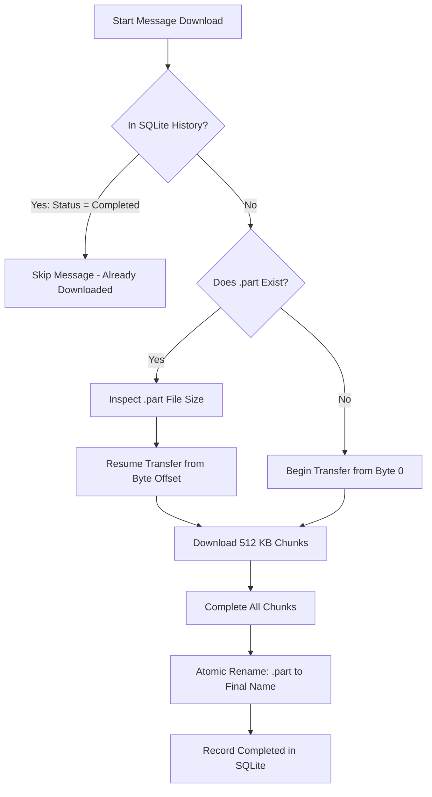

# Telegram Downloader

[](https://www.python.org/downloads/)
[](https://github.com/LonamiWebs/Telethon)
[](https://microsoft.com/windows)
[]()
[](LICENSE)

An enterprise-grade, high-reliability Telegram media downloader designed for seamless batch media acquisition, unattended 24/7 background operation, and intelligent forum topic subfolder routing on Windows.

---

## Table of Contents

- [Project Overview](#project-overview)
- [Key Features](#key-features)
- [Screenshot Gallery](#screenshot-gallery)
- [System Requirements](#system-requirements)
- [Installation Guide](#installation-guide)
- [First-Time Authentication](#first-time-authentication)
- [Application Usage](#application-usage)
  - [1. Login Tab](#1-login-tab)
  - [2. Browse & Search Channels](#2-browse--search-channels)
  - [3. Download List Manager](#3-download-list-manager)
  - [4. Downloader & Logs](#4-downloader--logs)
- [Folder & Storage Architecture](#folder--storage-architecture)
- [Resuming & Duplicate Prevention](#resuming--duplicate-prevention)
- [Headless Worker (24/7 Background Service)](#headless-worker-247-background-service)
- [Troubleshooting & FAQ](#troubleshooting--faq)
- [Security & Privacy](#security--privacy)
- [Automated Testing](#automated-testing)
- [Development Roadmap](#development-roadmap)
- [License](#license)

---

## Project Overview

**Telegram Downloader** provides a robust solution for backing up, organizing, and downloading large volumes of documents, videos, and media from Telegram broadcast channels, private groups, and native **Forum Supergroups**. 

Built with **Python**, **Telethon MTProto API**, and **SQLite WAL**, the application is optimized for high-throughput downloads with hardware-accelerated AES-NI cryptography, atomic chunking, and intelligent crash recovery. It features both a desktop Tkinter GUI and a dedicated headless daemon (`worker_headless.py`) for automated background execution.

---

## Key Features

- **Native Telegram User Authentication:** Direct official Telegram MTProto connection supporting user phone numbers, OTP verification, and optional Two-Factor Authentication (2FA).
- **Interactive Chat Catalog & Instant Filter:** Browse all accessible dialogs with real-time search filtering that preserves active queries when selecting channels.
- **Checkbox Multi-Selection:** Efficient bulk selection using checkboxes (`☐` / `☑`) with standard `Shift` and `Ctrl` range selection.
- **Persistent Download List Manager:** Retains selected target channels across sessions, displaying verified Telegram titles and chat types (`Broadcast Channel` vs `Forum Supergroup`).
- **Native Forum Topic Subfolder Routing (Stage B):** Automatically detects Telegram native forum supergroups, enumerates and caches forum topics, and routes messages directly into topic-specific directories (`<GroupName>/<TopicName>/<Filename>`). *(Implemented in source code and verified across 20 automated tests; pending separate controlled production database activation).*
- **Preserved Flat Layout for Ordinary Channels:** Non-forum broadcast channels and simple groups retain a clean flat folder structure (`<GroupName>/<Filename>`).
- **Resilient Chunked Resume:** Downloads media in 512 KB chunks to temporary `.part` files. If a connection drops, downloads resume from the exact byte offset without redownloading.
- **SQLite State Tracking & Duplicate Prevention:** Every completed download is tracked by Telegram channel ID and message ID in a local SQLite database in WAL mode. Completed files are never redownloaded.
- **Hardware-Accelerated Cryptography:** Seamlessly leverages `cryptg` / OpenSSL AES-NI for ultra-fast Telegram MTProto transport decryption.
- **Storage Safety Guards:** Real-time free disk space validation against configurable thresholds (`min_free_space_gb`). Downloads halt safely before filling the disk.
- **Decoupled Headless Worker:** Includes a headless background worker (`worker_headless.py`) with process locking (`instance_lock.py`), allowing unattended continuous downloading while the GUI runs in live monitoring mode.

---

## Screenshot Gallery

> [!NOTE]
> **Privacy & Demonstration Notice:** All screenshots illustrate the actual Tkinter desktop application running on Windows using simulated, privacy-masked channel titles (`UPP***`, `Pre***`), synthetic IDs (`1001-1007`), and simulated progress telemetry to protect personal account privacy and credentials.

All screenshots below represent the actual application interface running on Windows:

| Login & Authentication | Channel Catalog & Search |
| :---: | :---: |
|  |  |
| *Official Telegram OTP and 2FA authentication* | *Live channel catalog with search filtering* |

| Checkbox Multi-Selection | Persistent Download List Manager |
| :---: | :---: |
|  |  |
| *Bulk channel selection without search resets* | *Verified titles, forum supergroup detection & queue management* |

| Active Download Progress & Logs | Storage & Organization Settings |
| :---: | :---: |
|  |  |
| *Real-time speed, progress bar & MTProto logs* | *Forum topic subfolder toggle & storage space validation* |

---

## System Requirements

- **Operating System:** Windows 10, Windows 11, or Windows Server 2022+ (64-bit).
- **Python Version:** Python 3.10, 3.11, 3.12, or 3.13 (64-bit).
- **Core Dependencies:**
  - `Telethon==1.43.2`
  - `cryptg==0.6.0`
  - `python-dotenv==1.2.2`
  - `tkcalendar==1.6.1`
  - `babel==2.18.0`
  - `Pillow>=10.0.0`
- **Telegram Credentials:** Valid `API_ID` and `API_HASH` from [my.telegram.org](https://my.telegram.org).

---

## Installation Guide

Follow these step-by-step instructions in PowerShell to install and run the application:

### 1. Clone the Repository
```powershell
git clone https://github.com/RandhirSona/Telegram-Downloader.git
cd Telegram-Downloader
```

### 2. Create a Virtual Environment
```powershell
python -m venv .venv
.\.venv\Scripts\Activate.ps1
```

### 3. Install Required Dependencies
```powershell
python -m pip install --upgrade pip
pip install -r requirements.txt
```

### 4. Create Configuration Files
Copy the provided configuration templates:
```powershell
Copy-Item .env.example .env
Copy-Item config.json.example config.json
```

### 5. Obtain Telegram API Credentials
1. Log in to [https://my.telegram.org](https://my.telegram.org) using your Telegram phone number.
2. Navigate to **API development tools**.
3. Create a new application (e.g. named `MyDownloader`).
4. Copy your `api_id` and `api_hash`.
5. Open `.env` and fill in your credentials:
   ```ini
   API_ID=12345678
   API_HASH=0123456789abcdef0123456789abcdef
   PHONE=1234567890
   SESSION_NAME=anon
   ```

### 6. Configure Download Storage
Open `config.json` and set your desired download directory:
```json
{
  "download_directory": "D:\\TelegramDownloads",
  "min_free_space_gb": 5.0,
  "scan_interval_minutes": 15,
  "concurrent_downloads": 2,
  "organize_forum_topics": true,
  "media_filters": {
    "PDFs": true,
    "Videos": true,
    "Photos": false,
    "Voice/Audio": false,
    "Documents (Other)": false,
    "All Media": false
  },
  "cutoff_date": ""
}
```

### 7. Launch the Application
To launch the desktop GUI:
```powershell
.\.venv\Scripts\python.exe telegram_gui_downloader.py
```
*(Or double-click `start_downloader.bat`)*

---

## First-Time Authentication

When launching the application for the first time:

1. Navigate to the **Login** tab.
2. Confirm your phone number with your country code (e.g. `1234567890` without leading `+`).
3. Click **Send Code**. Telegram will deliver a login code to your official Telegram app or SMS.
4. Enter the code in the **OTP Code** box and click **Login**.
5. If Two-Factor Authentication is enabled on your account, enter your cloud password when prompted.
6. Once logged in, Telethon stores your credentials in an authorized session file (`anon.session`). Future launches authenticate automatically.

---

## Application Usage

### 1. Login Tab
Displays current authentication status, session validity, and controls for sending verification codes and logging in.

### 2. Browse & Search Channels
- Displays all channels and groups associated with your account.
- **Search Bar:** Real-time search by channel title or username. Search results remain visible when adding channels.
- **Checkbox Multi-Selection:** Check or uncheck individual items or use `Shift`/`Ctrl` range selection.
- **Bulk Action:** Click `Add Selected to Download List` to add items directly to your persistent queue.

### 3. Download List Manager
- Displays channels currently active in your download queue.
- Shows verified real titles, chat type (`Forum Supergroup` vs `Channel`), and date added.
- **Remove Selected:** Remove one or more channels from active queue.
- **Clear All Selections:** Clears all queued channels.

### 4. Downloader & Logs
- **Storage Destination:** Set and validate target download path with live free-space reporting.
- **Media Filters:** Toggle download of PDFs, Videos, Photos, Audio, and Other Documents.
- **Cutoff Date:** Filter out older messages prior to a specific date (`YYYY-MM-DD`).
- **Organization Setting:** Toggle *Organize Forum Supergroup Topics into Subfolders*.
- **Progress & Speed:** Green progress bar indicating active file completion percentage, live download speed (MB/s), and ETA.
- **Live Logs:** Real-time streaming log output detailing chunk downloads, rate limit handling, and topic routing.

---

## Folder & Storage Architecture

### Standard Broadcast Channels (Flat Layout)
Files from regular broadcast channels are stored in a dedicated channel directory:
```
D:\TelegramDownloads\
└── Tech Announcements\
    ├── Guidelines_2026.pdf
    └── Introduction_Video.mp4
```

### Forum Supergroups (Topic Subfolder Layout)
When *Organize Forum Supergroup Topics into Subfolders* is active:
```
D:\TelegramDownloads\
└── Discussion Supergroup\
    ├── General\
    │   └── welcome_notes.pdf
    ├── Mathematics\
    │   ├── lecture_01.mp4
    │   └── practice_set.pdf
    ├── Physics\
    │   └── lab_manual.pdf
    └── Unclassified\
        └── standalone_document.zip
```

### Sanitization & Safety
- **Windows Illegal Characters:** Automatically replaces invalid characters (`\ / : * ? " < > |`) with underscores (`_`).
- **Reserved Device Names:** Automatically avoids collisions with Windows reserved names (`CON`, `PRN`, `AUX`, `NUL`, `COM1-9`, `LPT1-9`).
- **Unicode Support:** Fully preserves multilingual titles (e.g. Hindi, Russian, Arabic, Chinese, Emoji).
- **Name Collisions:** Identical topic titles within the same supergroup are automatically disambiguated (e.g. `Notes` and `Notes [12]`).

---

## Resuming & Duplicate Prevention



- **Atomic Staging:** In-progress downloads write to `<filename>.part`. Only fully downloaded and verified files are promoted to their final filename.
- **Offset Resuming:** If network connectivity drops or the application restarts, downloads resume at the exact byte offset where they stopped.
- **Duplicate Prevention:** Completed files are recorded in SQLite `downloads` table with channel ID, message ID, file size, and path. Files are never downloaded twice.

---

## Headless Worker (24/7 Background Service)

For servers and unattended virtual machines, `worker_headless.py` runs as a continuous background daemon:

```powershell
.\.venv\Scripts\python.exe worker_headless.py
```

### Key Worker Capabilities
- **Reads Persistent Selections:** Automatically picks up channels saved in the SQLite `download_selections` table.
- **Periodic Scanning:** Loops through selected channels every `scan_interval_minutes` (default: 15 minutes).
- **Process Mutual Exclusion:** Uses `instance_lock.py` to prevent session conflicts between the GUI and background worker.
- **GUI Monitoring Mode:** If the background worker is running, launching the GUI automatically connects in read-only **Monitoring Mode**, displaying live download progress and logs without interrupting the worker.
- **Windows Task Scheduler:** Register the worker as an unattended startup task using `create_task_scheduler.bat`. See [docs/24X7_TASK_SCHEDULER.md](docs/24X7_TASK_SCHEDULER.md) for full instructions.

---

## Troubleshooting & FAQ

### 1. `Invalid API_ID or API_HASH`
Ensure you copied the exact numerical `API_ID` and 32-character hexadecimal `API_HASH` from [my.telegram.org](https://my.telegram.org) into `.env` without surrounding quotes or spaces.

### 2. `FloodWaitError` (Telegram Rate Limit)
Telegram temporarily restricts accounts that issue too many requests. The downloader automatically detects `FloodWaitError`, logs the wait time, and sleeps until the restriction expires before continuing.

### 3. `Storage Unavailable` or Insufficient Disk Space
If the target drive is detached or free space falls below `min_free_space_gb` (default: 5.0 GB), downloading pauses immediately with a warning. Reconnect your drive or free disk space, then click **Check Space**.

### 4. `Channel Private / Access Denied`
Ensure your Telegram account is currently a member of the target channel or group. For private channels, you must join the channel first before files can be enumerated.

### 5. Database Locked (`sqlite3.OperationalError`)
The database uses SQLite WAL mode (`PRAGMA journal_mode=WAL;`), allowing concurrent reads. Do not open `download_tracker.db` with external database editors in exclusive write mode while downloads are running.

---

## Security & Privacy

> [!WARNING]
> Never share or commit your `.env`, session files (`*.session`), or database (`download_tracker.db`) to public repositories.

- **Session Secrets:** Telegram session files contain active cryptographic keys that allow complete account access. They are strictly excluded via `.gitignore`.
- **Local Data Only:** No telemetry, downloaded content, or user credentials are transmitted to any third-party server. All data remains exclusively on your local machine.

---

## Automated Testing

The project includes an isolated unit test suite covering authentication mocks, checkbox multi-selection, database migrations, topic routing, and storage validation:

```powershell
.\.venv\Scripts\python.exe -m unittest discover tests -v
```

**Test Coverage Summary:**
- 20 / 20 Stage B Topic Routing Tests Passed
- 105 / 105 Total Unit Tests Passed (0 Regressions)

---

## Development Roadmap & Current Production Status

- [x] **Stage A (Live & Active in Production):** Verified Telegram channel titles and Browse checkbox multi-selection synchronization.
- [x] **Stage B (Implemented & Isolated Testing Complete):** Native Telegram forum supergroup detection, MTProto topic pagination, and folder-aware download routing. *(All 20 unit tests verified; live database migration pending separate controlled authorization).*
- [ ] **Stage C (In Preparation):** Safe historical existing-folder reconciliation (mapping legacy flat downloads to verified topic directories without modifying files prematurely).
- [ ] **Stage D (Planned):** Automated background archive extraction (`.zip`, `.rar`, `.7z`) for completed downloads.

---

## License

This project is licensed under the [MIT License](LICENSE).
