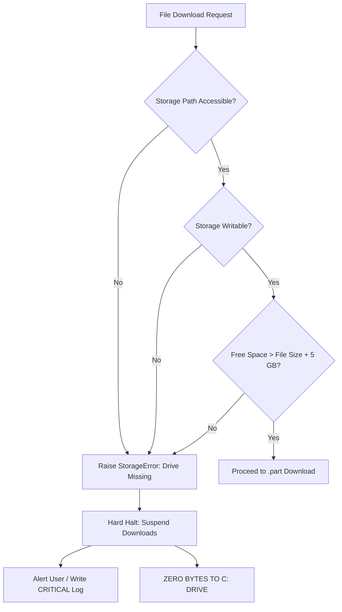

# Download Folder Enhancement & Storage Architecture Plan

This document details the architectural enhancements implemented to support dynamic, multi-terabyte storage configurations on Proxmox Windows VMs while strictly preventing silent fallbacks to the system drive (`C:\`).

---

## 1. Storage Architecture Overview

The Telegram Downloader decouples application execution (`C:\TelegramData`) from media storage (2 TB dedicated volume):

- **Configurable Drive Letter:** The application makes no assumptions about drive letters (`D:`, `E:`, `M:`, or UNC network paths).
- **Persistent Storage Record:** Stored in `config.json` under `"download_directory"`.
- **Live Disk Metric Telemetry:** Real-time query of total, used, and free space via `shutil.disk_usage`.
- **Safety Margin:** Enforces a minimum free space buffer (`min_free_space_gb`, default: 5.0 GB) before accepting transfers.

---

## 2. Strict No-C:-Fallback Guard

A common failure mode in media downloaders is falling back to the current working directory or `C:\` when a secondary drive is unavailable. In this application, this failure mode is strictly eliminated:

### Safety Rules Enforced:
1. **Hard Halt on Missing Target:** If the configured path does not exist or the drive is disconnected, the downloader immediately suspends downloading.
2. **Read-Only Storage Probe:** An atomic write-test probe file (`.storage_write_probe.tmp`) verifies filesystem write access before any Telegram messages are processed.
3. **Zero Silent Redirection:** The engine contains no fallback branches redirecting to `C:\` or default local folders.

---

## 3. Crash-Safe Staging (`.part`) & Collision Disambiguation

### 3.1 Temporary File Protocol
- Files are downloaded into `<filename>.ext.part`.
- Only upon 100% byte verification against Telegram's reported document size is the file promoted using `os.replace`.
- Incomplete downloads leave `.part` files that are never marked as complete in the database.

### 3.2 Collision Disambiguation
- If two messages in the same channel share an identical filename:
  - First message: `test_paper.pdf`
  - Second message: `test_paper [message_id].pdf`
- Both media files are preserved without data loss or overwrites.

---

## 4. SQLite WAL Download Tracker

Replacing flat JSON history files, `download_tracker.db` provides:
- Atomic message recording via `UNIQUE(channel_id, message_id)`.
- Automatic retry queue for failed messages (`status = 'FAILED'`).
- SQLite Write-Ahead Logging (`WAL`) enabling concurrent reads from the Tkinter GUI while the background worker writes download records.
